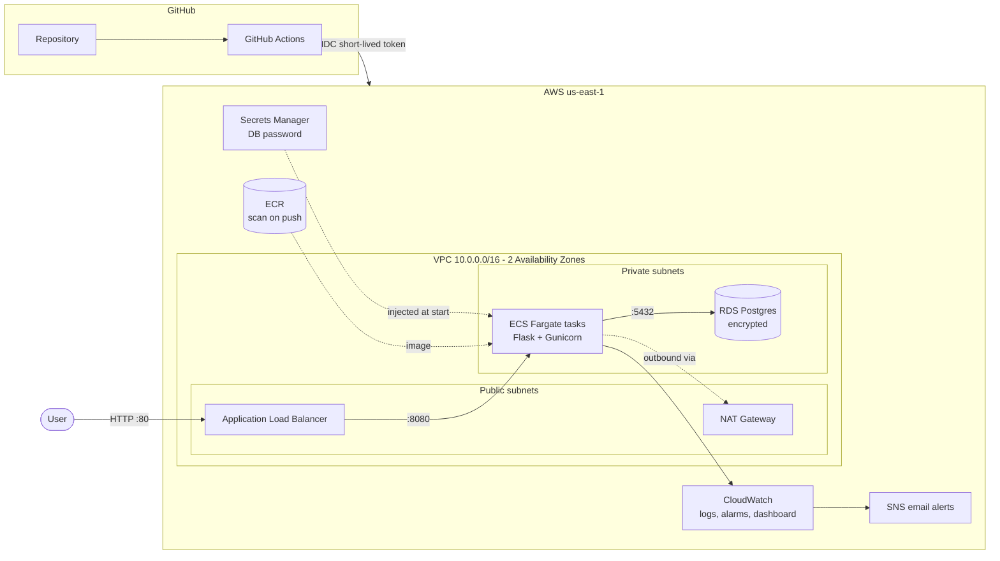

# Cloud Portfolio App: a production-style 3-tier app on AWS

A job application tracker running on **AWS ECS Fargate** behind an **Application Load Balancer**, backed by **RDS Postgres**, built entirely with **Terraform** and deployed by **GitHub Actions** using **OIDC** (no stored AWS keys). Every change is security-scanned with **Checkov** (infrastructure) and **Trivy** (container image).

   

## Architecture



Traffic only flows one way through the tiers: the internet can reach the load balancer, the load balancer can reach the app, and only the app can reach the database. The containers and the database have no public IP addresses.

## Tech stack

| Area | Tools |
| --- | --- |
| Infrastructure as Code | Terraform (reusable modules, S3 remote state with native locking, dev + prod environments) |
| Networking | VPC, public/private subnets across 2 AZs, NAT gateway, security groups chained by tier, VPC flow logs |
| Compute | Docker, Amazon ECR, ECS Fargate, Application Load Balancer, CPU target-tracking autoscaling |
| Data | RDS Postgres 16 (encrypted, private, automated backups), password managed by Secrets Manager |
| CI/CD | GitHub Actions: plan on pull request, apply on merge, build/test/scan/deploy the app |
| Security | OIDC federation (no access keys), least-privilege IAM, Checkov, Trivy, ECR scan on push |
| Observability | CloudWatch Logs, dashboard, alarms (unhealthy hosts, 5XX, CPU, DB storage) to SNS email |
| Cost | Default tags on every resource, AWS Budgets alert, one-command teardown |

## Repository layout

```
app/                      Flask app, Dockerfile, unit tests
terraform/
  bootstrap/              State bucket, GitHub OIDC role, budget (run once)
  modules/
    network/              VPC, subnets, NAT, route tables, flow logs
    security/             Security groups (ALB -> app -> DB)
    ecr/                  Container registry + lifecycle policy
    database/             RDS Postgres + Secrets Manager password
    compute/              ALB, ECS cluster/service/task, IAM roles, autoscaling
    monitoring/           SNS, CloudWatch alarms, dashboard
  envs/
    dev/                  Small and cheap: 1 task, 1 NAT, single-AZ DB
    prod/                 Resilient: 2+ tasks, NAT per AZ, Multi-AZ DB, deletion protection
.github/workflows/
  terraform.yml           Checkov -> fmt/validate/plan (dev + prod) -> apply dev on main
  deploy.yml              pytest -> docker build -> Trivy -> push to ECR -> ECS rolling deploy
scripts/                  deploy.ps1 / destroy.ps1 for local first-time setup and teardown
```

## How the pipelines work

**Infrastructure (`terraform.yml`)**
1. A pull request that touches `terraform/` runs Checkov, then `fmt`, `validate`, and `plan` for **both** dev and prod, so reviewers see exactly what would change.
2. Merging to `main` re-plans and applies to dev.

**Application (`deploy.yml`)**
1. Unit tests run with pytest.
2. The Docker image is built and scanned by Trivy. The build fails on any fixable HIGH or CRITICAL vulnerability.
3. The image is pushed to ECR tagged with the **commit SHA**, so every running version traces back to an exact commit.
4. A new ECS task definition revision is registered and the service does a rolling deployment. If the new version fails health checks, the **deployment circuit breaker rolls back** automatically.

GitHub authenticates to AWS with **OIDC**: each run gets a token that expires within the hour, and the IAM role only trusts this repository. There are no AWS access keys stored in GitHub.

## Design decisions

- **ECS Fargate instead of EKS.** One small service doesn't need a Kubernetes control plane (~$73/month on its own). Fargate means no servers to patch, and the same container would move to EKS unchanged.
- **One NAT gateway in dev, one per AZ in prod.** A NAT gateway costs about $32/month. Dev trades AZ redundancy for cost; prod keeps it.
- **Database password never touches code or Terraform state.** `manage_master_user_password` makes RDS generate the password and store it in Secrets Manager. ECS reads it at container start, and the execution role can read that one secret only.
- **Health check doesn't hit the database.** `/health` is a cheap liveness check for the load balancer, so a brief database blip doesn't make every container look dead. `/ready` checks the database separately.
- **Terraform ignores the service's task definition and desired count.** The pipeline deploys new image versions and autoscaling changes the task count, so Terraform must not reverse either.
- **Native S3 state locking.** Terraform 1.10+ locks state with a lock file in S3, so no DynamoDB table is needed.
- **Pipeline IAM is scoped.** The GitHub role has PowerUser for services, but can only create or change IAM roles whose names start with `portfolio-`.
- **Every Checkov skip is justified in code.** Each skipped check has a one-line reason next to it (cost, no domain for TLS yet, or a cross-module false positive).

## Cost

| Resource (dev) | Approx. cost |
| --- | --- |
| NAT gateway | ~$1.08/day |
| Application Load Balancer | ~$0.55/day |
| RDS db.t4g.micro + 20 GB | ~$0.45/day |
| Fargate (1 task, 0.25 vCPU / 0.5 GB) | ~$0.30/day |
| Public IPv4 addresses, logs, ECR | ~$0.40/day |
| **Total while running** | **~$2.75/day (~$85/month)** |

Estimates for us-east-1 at on-demand prices; check the AWS Pricing Calculator for current rates. Tear dev down when you're not using it: `.\scripts\destroy.ps1`. Rebuilding takes about 15 minutes.

## Deploy it yourself

Requirements: AWS account, AWS CLI v2 (signed in with `aws sso login`), Terraform 1.10+, Docker, Git.

```powershell
# 1. Set where alerts go (kept out of the repo)
$env:TF_VAR_alert_email = "you@example.com"

# 2. Bootstrap + first deploy (about 15 minutes)
.\scripts\deploy.ps1
```

Then, in GitHub, go to **Settings > Secrets and variables > Actions > Variables** and add:

| Variable | Value |
| --- | --- |
| `AWS_ROLE_ARN` | `github_actions_role_arn` output from `terraform/bootstrap` |
| `ALERT_EMAIL` | your email address |

After that, every push to `main` deploys automatically.

**Teardown:** `.\scripts\destroy.ps1`

## What I'd do next

- HTTPS with a custom domain: Route 53 + ACM certificate, and redirect HTTP to HTTPS
- AWS WAF on the load balancer
- Manual approval gate before applying to prod
- Blue/green deployments with CodeDeploy
- VPC endpoints for ECR, Secrets Manager and CloudWatch to cut NAT data costs
- Multi-region disaster recovery with an RDS cross-region read replica
